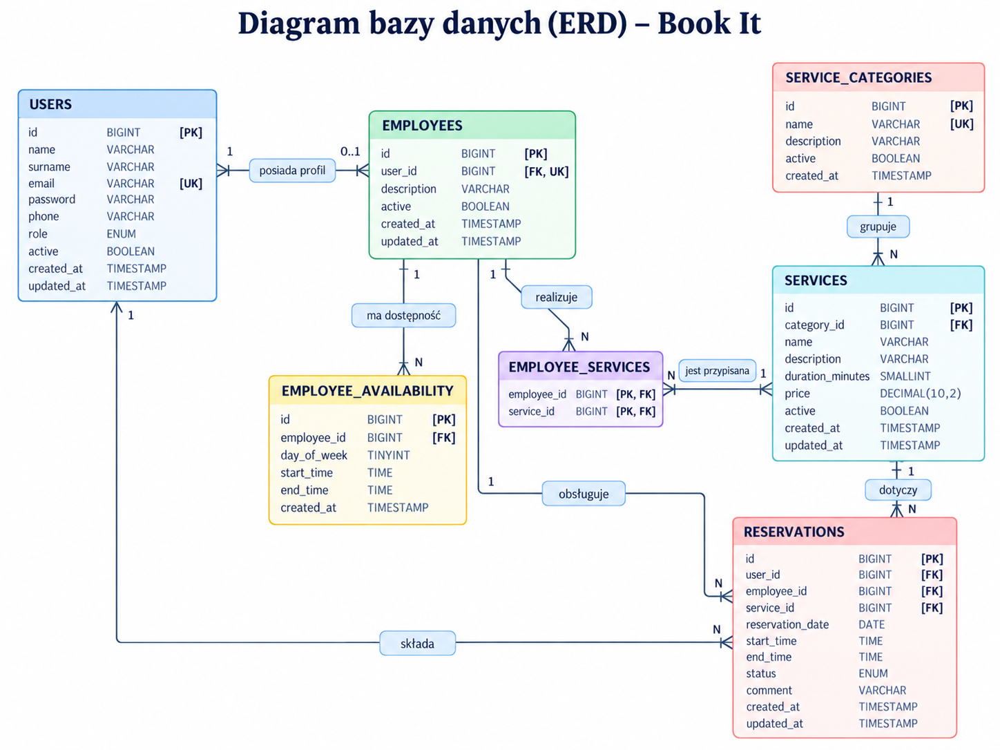

# book.it

Aplikacja online: [bookit.freedev.app](https://bookit.freedev.app/)

**book.it** to internetowa platforma do rezerwacji usług, która umożliwia klientom znalezienie firmy, zapoznanie się z jej ofertą oraz zarezerwowanie dostępnego terminu online.

W przeciwieństwie do tradycyjnych systemów rezerwacji przeznaczonych dla jednej firmy, book.it obsługuje wielu niezależnych usługodawców w ramach jednej aplikacji. Każda firma może posiadać własny profil, ofertę usług, pracowników, godziny dostępności oraz rezerwacje.

Projekt powstaje w ramach przedmiotu **Tworzenie stron i aplikacji internetowych**.

## O projekcie

Celem projektu jest stworzenie uniwersalnego systemu rezerwacji, z którego mogą korzystać różnego rodzaju firmy świadczące usługi, między innymi:

- salony fryzjerskie i kosmetyczne,
- warsztaty samochodowe,
- serwisy komputerowe,
- studia fotograficzne,
- firmy sprzątające,
- szkoły językowe i korepetytorzy,
- trenerzy personalni,
- inni usługodawcy pracujący w oparciu o rezerwacje terminów.

Użytkownik korzysta z jednego konta book.it, za pomocą którego może rezerwować usługi w różnych firmach dostępnych na platformie.

Każda firma posiada własną ofertę i pracowników. Poszczególni pracownicy mogą wykonywać różne usługi oraz posiadać indywidualne godziny pracy i dostępność.

Docelowy proces rezerwacji wygląda następująco:

```text
Firma → Usługa → Pracownik → Data → Godzina → Potwierdzenie
```

System będzie automatycznie wyznaczał dostępne terminy na podstawie czasu trwania usługi, godzin pracy pracownika oraz istniejących rezerwacji.

## Autorzy

- Kacper Księżopolski
- Krystian Kurkus

## Technologie

- PHP 8.2+
- HTML5
- CSS3
- JavaScript
- MySQL / MariaDB
- GitHub

## Funkcjonalności

Projekt jest rozwijany etapami. Aktualnie zaimplementowano:

- rejestrację konta klienta i firmy;
- wspólny system logowania i wylogowania;
- obsługę kont użytkowników oraz uprawnień;
- możliwość posiadania własnej firmy w ramach platformy;
- edycję danych osobowych i kontaktowych;
- zmianę hasła oraz PIN-u zabezpieczającego;
- odzyskiwanie dostępu do konta za pomocą adresu e-mail i PIN-u;
- podstawowe panele klienta, właściciela firmy, pracownika i administratora;
- relacyjną bazę danych z przykładowymi firmami, usługami, pracownikami i rezerwacjami;
- responsywny interfejs użytkownika.

System wykorzystuje sesje użytkowników, hashowanie haseł i PIN-ów, walidację danych oraz mechanizmy ochrony formularzy.

## Planowane funkcjonalności

W kolejnych etapach przewidziano:

- tworzenie i edycję profili firm;
- zarządzanie usługami, kategoriami i pracownikami;
- konfigurację godzin pracy i dostępności;
- wyszukiwanie firm oraz przeglądanie ich ofert;
- wyznaczanie wolnych terminów;
- dokonywanie i zarządzanie rezerwacjami;
- rozbudowę paneli użytkowników.

Pełny proces rezerwacji i zarządzania działalnością nie jest jeszcze zaimplementowany.

## Struktura katalogów

```text
.
├── app/
│   ├── views/
│   ├── accounts.php
│   ├── config.php
│   ├── controller.php
│   └── security.php
├── assets/
│   └── diagram_baza.png
├── database/
│   ├── migrations/
│   └── database.sql
├── docs/
|   ├── ERD.md
|   ├── ARCHITEKTURA.md
|   └── BEZPIECZENSTWO.md
├── public/
│   ├── css/
│   ├── js/
│   └── index.php
├── .env.example
├── .gitignore
└── README.md
```

## Baza danych

Projekt wykorzystuje relacyjną bazę danych MySQL/MariaDB.

Struktura bazy obejmuje między innymi:

- konta użytkowników i ich uprawnienia;
- firmy oraz powiązania użytkowników z firmami;
- kategorie i usługi;
- profile pracowników i przypisane im usługi;
- godziny dostępności;
- rezerwacje.

Baza danych zawiera klucze główne i obce, ograniczenia integralności oraz indeksy.

Pełny schemat i przykładowe dane znajdują się w pliku `database/database.sql`.

## Uruchomienie

Do lokalnego uruchomienia aplikacji wymagane są PHP 8.2+ oraz MySQL lub MariaDB. Można skorzystać ze środowiska XAMPP.

1. Pobierz lub sklonuj repozytorium.
2. Skopiuj plik `.env.example` do `.env` i uzupełnij dane połączenia z bazą danych.
3. Wygeneruj klucz aplikacji i umieść go w zmiennej `APP_KEY` w pliku `.env`:

   ```bash
   php -r "echo bin2hex(random_bytes(32));"
   ```

4. Zaimportuj `database/database.sql` do nowej bazy MySQL/MariaDB.
5. Uruchom serwer PHP z katalogiem `public` jako katalogiem głównym:

   ```bash
   php -S localhost:8000 -t public
   ```

6. Otwórz w przeglądarce:

   http://localhost:8000

Alternatywnie aplikację można uruchomić za pomocą XAMPP, ustawiając katalog `public` jako katalog udostępniany przez serwer.

## Konta testowe

Baza danych zawiera przykładowe konta umożliwiające sprawdzenie działania aplikacji.

| Konto | E-mail |
|---|---|
| Administrator | `admin@bookit.test` |
| Klient | `klient@bookit.test` |
| Pracownik | `anna.nowak@bookit.test` |
| Pracownik | `piotr.wisniewski@bookit.test` |
| Właściciel firmy | `firma@bookit.test` |

Hasło kont testowych: `Bookit-Demo-2026!`

Konta demonstracyjne są przeznaczone wyłącznie do testów lokalnych. PIN można ustawić w ustawieniach konta po zalogowaniu.

## Diagram bazy danych



*Diagram przedstawia pierwotny schemat bazy danych z Etapu 1. Aktualny model uwzględnia również firmy, członkostwa i dodatkowe elementy systemu kont.*

## Dokumentacja

- [Diagram i opis relacji](docs/ERD.md)
- [Architektura aplikacji](docs/ARCHITEKTURA.md)
- [Bezpieczeństwo](docs/BEZPIECZENSTWO.md)
- [Skrypt bazy danych](database/database.sql)