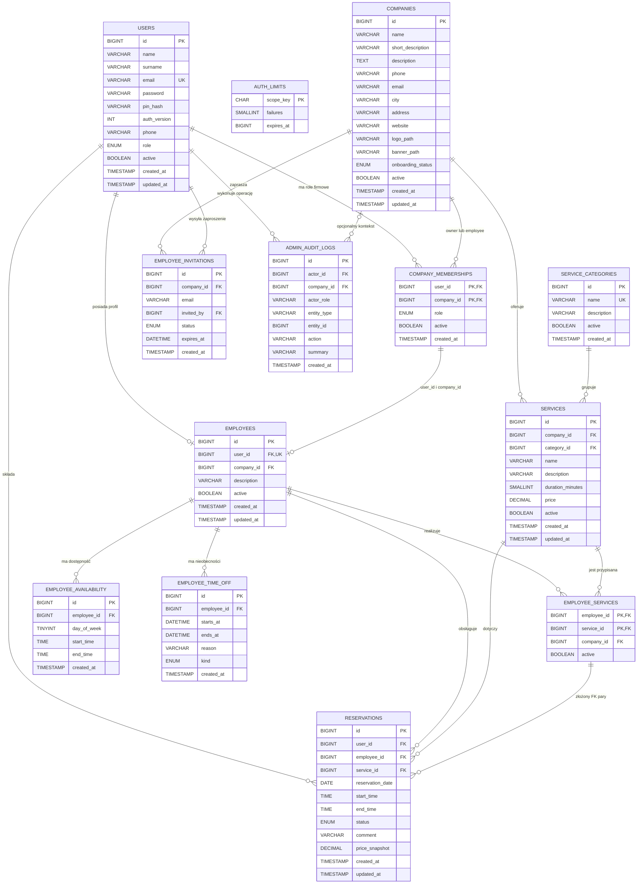

# Diagram ERD

Diagram odpowiada końcowemu schematowi z `database/database.sql` oraz migracji `002_auth_multi_company.sql` i `003_admin_brand_management.sql` (13 tabel). Wartości `1`–`7` w `employee_availability.day_of_week` oznaczają dni od poniedziałku do niedzieli. Historyczny PNG w assets pokazuje wyłącznie Etap 1.

## Relacje

- `users` 1:0..1 `employees` — jedno konto może mieć najwyżej jeden profil pracownika; zapewnia to `UNIQUE(employees.user_id)`.
- `service_categories` 1:N `services` — usługa należy do jednej kategorii.
- `employees` N:M `services` — relację realizuje tabela łącząca `employee_services` ze złożonym kluczem głównym.
- `employees` 1:N `employee_availability` — pracownik może mieć wiele przedziałów dostępności.
- `users` 1:N `reservations` — użytkownik będący klientem może utworzyć wiele rezerwacji.
- `employees` 1:N `reservations` — pracownik może obsłużyć wiele rezerwacji.
- `services` 1:N `reservations` — usługa może wystąpić w wielu rezerwacjach.
- Złożony klucz obcy `reservations(employee_id, service_id)` gwarantuje, że rezerwacja dotyczy usługi przypisanej danemu pracownikowi.

## Zmiany Etapu 2

- Nowe: companies, company_memberships i auth_limits. AUTH_LIMITS celowo nie ma FK do użytkownika: zabezpiecza także nieistniejące identyfikatory i adresy IP, zapisane jako HMAC.
- Właściciel firmy to company_memberships.role=owner. Nie ma osobnego owner_id ani automatycznego globalnego admina. Rejestracja zapisuje użytkownika, firmę i członkostwo w jednej transakcji.
- users.password to hash; pin_hash może być NULL dla starych kont i seedów. auth_version unieważnia sesje i wykorzystane granty.
- companies.onboarding_status: pending albo ready. Rejestracja i migracja 002 tworzą pending; migracja 003 nie zmienia stanu. Regułę gotowości egzekwuje aplikacja.
- services ma UNIQUE(company_id,category_id,name) zamiast dawnego UNIQUE(category_id,name), a także UNIQUE(id,company_id).
- employees zachowuje UNIQUE(user_id), dodaje UNIQUE(id,company_id) i złożony FK(user_id,company_id) do company_memberships. Firma pracownika wynika z tego FK.
- employee_services zachowuje PK(employee_id,service_id) i oba stare FK; dodatkowo FK(employee_id,company_id) → employees(id,company_id) oraz FK(service_id,company_id) → services(id,company_id) uniemożliwiają mieszanie firm.
- reservations i employee_availability zachowują kolumny oraz relacje Etapu 1. Firma wynika z relacji pracownika i usługi; nie ma redundantnego company_id rezerwacji.
- Zachowano wszystkie dotychczasowe CHECK i indeksy. Nowe indeksy: członkostwa (company_id,role), wygaśnięcie limitów (expires_at) oraz indeksy wspierające nowe FK/UNIQUE.
- Migracja przypisuje istniejące usługi i pracowników do jednej firmy, nie usuwa danych i nie ustanawia arbitralnego właściciela. Seed nowej instalacji dodaje osobne fikcyjne konto właścicielki.

## Kontrakt Etapu 3

| Tabela | Nowe pola / zasady |
|---|---|
| `companies` | `short_description VARCHAR(255)`, `phone VARCHAR(30)`, `email VARCHAR(190)`, `city VARCHAR(100)`, `address VARCHAR(255)`, `website VARCHAR(255)` mają `NOT NULL DEFAULT ''`. `description TEXT`, `logo_path VARCHAR(100)` i `banner_path VARCHAR(100)` dopuszczają NULL. |
| `services` | `duration_minutes` zachowuje `SMALLINT UNSIGNED NOT NULL` i CHECK dodatniości; nowy DEFAULT wynosi 45. Dawne wartości pozostają bez zmian. |
| `employee_services` | `active BOOLEAN NOT NULL DEFAULT 1`, CHECK dopuszcza tylko 0/1. Dezaktywacja zachowuje parę wymaganą przez historyczne rezerwacje. |
| `reservations` | `price_snapshot DECIMAL(10,2) NULL`, CHECK dopuszcza NULL lub cenę nieujemną. Bez backfillu: NULL oznacza cenę historyczną nieznaną, nie zero. |
| `employee_time_off` | `id BIGINT UNSIGNED AUTO_INCREMENT`, `employee_id BIGINT UNSIGNED`, `starts_at/ends_at DATETIME`, `reason VARCHAR(255)`, `kind ENUM('holiday','break','day_off')`, `created_at TIMESTAMP DEFAULT CURRENT_TIMESTAMP`; wszystkie NOT NULL. CHECK wymaga końca po początku i prawidłowego rodzaju. |
| `employee_invitations` | `id BIGINT UNSIGNED AUTO_INCREMENT`, `company_id/invited_by BIGINT UNSIGNED`, `email VARCHAR(190)`, `status ENUM('pending','accepted','declined','cancelled') DEFAULT 'pending'`, `expires_at DATETIME`, `created_at TIMESTAMP DEFAULT CURRENT_TIMESTAMP`; wszystkie NOT NULL. CHECK odrzuca pusty e-mail i nieprawidłowy status. |
| `admin_audit_logs` | `id BIGINT UNSIGNED AUTO_INCREMENT`, `actor_id/entity_id BIGINT UNSIGNED`, `company_id BIGINT UNSIGNED NULL`, `actor_role VARCHAR(20)`, `entity_type/action VARCHAR(40)`, `summary VARCHAR(1000)`, `created_at TIMESTAMP DEFAULT CURRENT_TIMESTAMP`; pozostałe pola NOT NULL. CHECK odrzuca puste rolę, typ, akcję i podsumowanie. |

Nowe FK mają `ON DELETE RESTRICT ON UPDATE RESTRICT`: nieobecność → pracownik, zaproszenie → firma i zapraszający użytkownik, audyt → aktor i opcjonalnie firma. Chronią zależności przed fizycznym usunięciem. Istniejące FK pozostają bez zmian, w tym ochrona historii rezerwacji i zgodności firm w `employee_services`. Nie dodano nowych UNIQUE: kolejne zaproszenia i zdarzenia audytu są legalne, a dokładna unikalność przedziału nie rozwiązałaby nakładania terminów.

Indeksy Etapu 3:

- `reservations(reservation_date,id)` — globalna lista i paginacja po dacie, również bez filtra statusu; dotychczasowe indeksy pracownika/statusu pozostają.
- `employee_time_off(employee_id,starts_at,ends_at)` — wyszukiwanie nieobecności pracownika przecinających zakres.
- `employee_invitations(company_id,status,id)`, `(email,status,expires_at)` i `(invited_by)` — listy firmowe, odbiór niewygasłych zaproszeń i FK autora.
- `admin_audit_logs(created_at,id)`, `(company_id,created_at,id)`, `(actor_id,created_at,id)`, `(action,created_at,id)`, `(entity_type,entity_id,id)` — stabilna paginacja globalna/firmowa, filtry oraz historia obiektu.

## Ograniczenia modelu i odpowiedzialność aplikacji

- Jeden użytkownik nadal ma najwyżej jeden profil `employees` (UNIQUE `user_id`). Migracja nie rozszerza zatrudnienia na kilka firm.
- Firma nieobecności wynika z pracownika. Przedziały są półotwarte `[starts_at, ends_at)`; stykające się granice nie kolidują. CHECK nie wykrywa nakładania różnych wierszy ani konfliktu z rezerwacją. Aplikacja musi kontrolować je transakcyjnie, serializując zmiany grafiku danego pracownika. Etap 4 odejmuje wszystkie trzy rodzaje nieobecności od grafiku.
- Daty DATETIME nie zawierają strefy. `starts_at`, `ends_at` należy interpretować w tej samej strefie co terminy rezerwacji (Europe/Warsaw); aplikacja musi jawnie uzgodnić strefę `expires_at` i połączenia dla TIMESTAMP. Nie porównujemy tych kolumn w CHECK, aby nie uzależniać walidacji od konwersji strefy sesji.
- Zaproszenie jest powiązane z uwierzytelnionym adresem e-mail, nie stanowi tokena dostępu. Aplikacja normalizuje adres, weryfikuje tożsamość odbiorcy, uprawnienia autora, `status='pending'` i `expires_at` oraz atomowo akceptuje zaproszenie. SQL nie sprawdza formatu adresu, wygaśnięcia ani przejść statusów; nie zabrania równoległych zaproszeń dla tego samego adresu.
- `entity_type/entity_id` audytu to odwołanie polimorficzne bez FK, pozwalające zachować opis usuniętego obiektu. `company_id=NULL` oznacza operację globalną. FK aktora nie sprawdza jego uprawnień; `actor_role` zapisuje kontekst w chwili zdarzenia. Aplikacja zapisuje operację i audyt w jednej transakcji, bez sekretów, z podsumowaniem `old_status → new_status` przy zmianie statusu. Sama tabela nie jest odporna na modyfikacje przez konto mające UPDATE/DELETE.
- Puste dane profilu umożliwiają migrację i rejestrację przed onboardingiem. SQL nie waliduje kontaktu, URL, bezpieczeństwa uploadu ani gotowości firmy. Ścieżki logo i baneru powinny być względnymi identyfikatorami zatwierdzonych mediów, nigdy ścieżką podaną bezpośrednio przez użytkownika.
- Nowe rezerwacje powinny otrzymywać snapshot ceny w transakcji zapisu. Historycznych NULL nie należy przedstawiać jako rzeczywistego przychodu ani zastępować bieżącą ceną usługi.

## Uruchomienie i odzyskiwanie migracji 003

1. Zatrzymaj zapisy aplikacji. Wykonaj kopię schematu i danych, sprawdź jej odtworzenie na osobnej bazie. Zachowaj wynik `SHOW CREATE TABLE` i liczności tabel.
2. Na bazie po pełnej migracji 002 uruchom `database/preflight_003.sql`. Skrypt wykonuje wyłącznie SELECT; wskazuje wersję, tryb SQL, silniki, kolizje obiektów 003, błędne relacje/wartości, nakładanie grafików/rezerwacji oraz liczności. Rozwiąż niezerowe wyniki przed migracją. Nie jest automatyczną blokadą ani pełnym porównaniem struktury — brak tabel/kolumn lub błąd zapytania także oznacza przerwanie procedury.
3. Użyj InnoDB, utf8mb4, włączonych FK, trybu strict i serwera egzekwującego CHECK. Wsparcie konkretnej wersji MySQL/MariaDB wymaga testu importu oraz próby odrzucenia nieprawidłowych danych; nie polegaj wyłącznie na zaakceptowaniu składni CHECK.
4. Wykonaj `database/migrations/003_admin_brand_management.sql` dokładnie raz w wybranej bazie. Skrypt nie zawiera USE, seedów, UPDATE starych danych, kasowania tabel ani wyłączania FK. Nie uruchamiaj klienta z opcją kontynuacji po błędzie.
5. DDL wykonuje implicit commit; cała migracja nie jest atomowa. ALTER może blokować tabele i wymaga miejsca na dysku. Po awarii nie uruchamiaj pliku ponownie w ciemno: sprawdź ukończone instrukcje i strukturę. Przywróć zweryfikowaną kopię z zachowaniem zatrzymanych zapisów albo przygotuj kontrolowane dokończenie od pierwszej niewykonanej instrukcji. Nie ma automatycznego rollbacku ani ukrywania rozbieżności przez IF NOT EXISTS.
6. Porównaj dane starych kolumn, liczności, czasy usług i FK; sprawdź DEFAULT 45, NULL snapshotów, nowe CHECK i RESTRICT. Dopiero potem wznów zapisy.

`database/database.sql` zachowuje układ historycznych CREATE + migracja 002 + lokalne seedy + identyczna migracja 003. To kompletny import **wyłącznie do pustej instalacji lokalnej**; zawiera demonstracyjne konta. Istniejąca instalacja Etapu 2 uruchamia wyłącznie preflight i 003. Pełnego importu nie wykonuje się na działającej bazie.

Porównanie SQL-02 powinno obejmować `SHOW CREATE TABLE` wszystkich 13 tabel po pełnym imporcie i po ścieżce Etap 1 → 002 → 003, z pominięciem wyłącznie licznika AUTO_INCREMENT. Seed właścicielki i zmiana demonstracyjnych haseł należą tylko do pełnego importu, więc migracje istniejącej instalacji celowo nie odtwarzają tych danych.

## Wyniki weryfikacji SQL — 2026-11-05

Testy wykonano klientem SQL na odizolowanej instancji MariaDB 10.4.32 w katalogu tymczasowym, bez połączenia z bazą aplikacji. Po testach instancję zatrzymano. Nie instalowano bibliotek i nie uruchamiano przeglądarki.

| Test | Wynik |
|---|---|
| SQL-01: Etap 1 → 002 → 003, porównanie wszystkich starych kolumn i wierszy w 10 tabelach | PASS — bez utraty lub zmiany danych |
| SQL-02: pełny import i migracje, SHOW CREATE TABLE wszystkich 13 tabel | PASS — identyczne definicje po pominięciu AUTO_INCREMENT |
| INSERT usługi bez czasu, historyczne czasy, brak backfillu cen, aktywność istniejących przypisań | PASS — odpowiednio 45, wartości zachowane, NULL, 1 |
| 15 prób naruszenia nowych CHECK/FK/ENUM | PASS — odrzucone |
| CHECK obu nowych ENUM bez trybu strict | PASS — puste wartości odrzucone |
| Poprawne wpisy trzech nowych tabel, audyt globalny z NULL, cena 0, dezaktywacja przypisania z historią | PASS |
| Usuwanie rodziców wszystkich pięciu nowych FK na izolowanych rekordach | PASS — RESTRICT blokuje usunięcie |
| Preflight poprawnej bazy Etapu 2 | PASS — brak zgłoszonych naruszeń |
| Preflight celowo błędnych danych | PASS — wykrywa czas 0, przypisanie między firmami oraz nakładanie grafików i aktywnych rezerwacji |
| Preflight po wykonaniu 003 | PASS — wykrywa istniejące obiekty migracji |
| Synchronizacja treści 003 w pełnym SQL i niezmienność 002 | PASS |
| Import na MySQL oraz innych wersjach MariaDB | NOT RUN — przetestowano wyłącznie lokalną MariaDB 10.4.32 |

To weryfikacja kontraktu bazy, nie potwierdzenie działania interfejsu, autoryzacji ani pełnego Etapu 3. Przed migracją rzeczywistych danych nadal obowiązują kopia zapasowa, preflight i próba na kopii konkretnej instalacji.
