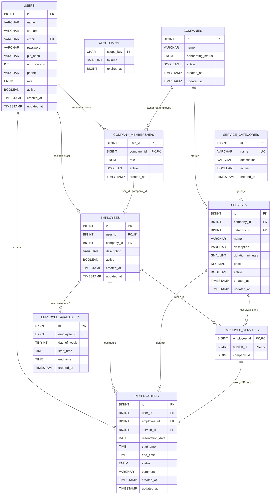

# Diagram ERD

Diagram odpowiada końcowemu schematowi z `database/database.sql` oraz migracji `002_auth_multi_company.sql` (10 tabel). Wartości `1`–`7` w `employee_availability.day_of_week` oznaczają dni od poniedziałku do niedzieli. Historyczny PNG w assets pokazuje wyłącznie Etap 1.

## Relacje

- `users` 1:0..1 `employees` — jedno konto może mieć najwyżej jeden profil pracownika; zapewnia to `UNIQUE(employees.user_id)`.
- `service_categories` 1:N `services` — usługa należy do jednej kategorii.
- `employees` N:M `services` — relację realizuje tabela łącząca `employee_services` ze złożonym kluczem głównym.
- `employees` 1:N `employee_availability` — pracownik może mieć wiele przedziałów dostępności.
- `users` 1:N `reservations` — użytkownik będący klientem może utworzyć wiele rezerwacji.
- `employees` 1:N `reservations` — pracownik może obsłużyć wiele rezerwacji.
- `services` 1:N `reservations` — usługa może wystąpić w wielu rezerwacjach.
- Złożony klucz obcy `reservations(employee_id, service_id)` gwarantuje, że rezerwacja dotyczy usługi przypisanej danemu pracownikowi.

## Zmiany Etapu 2

- Nowe: companies, company_memberships i auth_limits. AUTH_LIMITS celowo nie ma FK do użytkownika: zabezpiecza także nieistniejące identyfikatory i adresy IP, zapisane jako HMAC.
- Właściciel firmy to company_memberships.role=owner. Nie ma osobnego owner_id ani automatycznego globalnego admina. Rejestracja zapisuje użytkownika, firmę i członkostwo w jednej transakcji.
- users.password to hash; pin_hash może być NULL dla starych kont i seedów. auth_version unieważnia sesje i wykorzystane granty.
- companies.onboarding_status: pending albo ready. Rejestracja i migracja tworzą pending; obecny UI nie ustawia ready.
- services ma UNIQUE(company_id,category_id,name) zamiast dawnego UNIQUE(category_id,name), a także UNIQUE(id,company_id).
- employees zachowuje UNIQUE(user_id), dodaje UNIQUE(id,company_id) i złożony FK(user_id,company_id) do company_memberships. Firma pracownika wynika z tego FK.
- employee_services zachowuje PK(employee_id,service_id) i oba stare FK; dodatkowo FK(employee_id,company_id) → employees(id,company_id) oraz FK(service_id,company_id) → services(id,company_id) uniemożliwiają mieszanie firm.
- reservations i employee_availability zachowują kolumny oraz relacje Etapu 1. Firma wynika z relacji pracownika i usługi; nie ma redundantnego company_id rezerwacji.
- Zachowano wszystkie dotychczasowe CHECK i indeksy. Nowe indeksy: członkostwa (company_id,role), wygaśnięcie limitów (expires_at) oraz indeksy wspierające nowe FK/UNIQUE.
- Migracja przypisuje istniejące usługi i pracowników do jednej firmy, nie usuwa danych i nie ustanawia arbitralnego właściciela. Seed nowej instalacji dodaje osobne fikcyjne konto właścicielki.

Test integracyjny porównuje SHOW CREATE TABLE wszystkich 10 tabel po imporcie pełnego SQL i po migracji Etapu 1; pomija wyłącznie licznik AUTO_INCREMENT.
